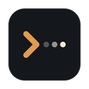

<p align="center"></p>

<h1 align="center">Huntaway</h1>

<p align="center">Drive your <a href="https://herdr.dev">Herdr</a> coding agents (Claude Code, Codex) from your phone or your computer:<br>see what they are doing, answer them, unblock them, know when they are done.</p>

---

## How it works

Your agents run in [Herdr](https://herdr.dev), on your computer and on your servers. On each machine, a small daemon, **`huntawayd`**, follows the Herdr sessions and reads the agents' conversations. The Huntaway apps connect to these daemons:

```
   📱 Mobile app (Android)          💻 Desktop app (macOS, Linux)
            │                                  │
            └──────────── Tailscale ───────────┤  (or local network)
                                               │
        ┌──────────────────────┬───────────────┴──────┐
        ▼                      ▼                      ▼
   huntawayd              huntawayd              huntawayd
   your Mac (local)       dev server             GPU server…
        │                      │                      │
   Herdr sessions         Herdr sessions         Herdr sessions
   Claude Code, Codex…    Claude Code, Codex…    …
```

- **One place for everything**: the app gathers the agents of all your machines. Agents waiting for an answer come first.
- **The conversation, not the terminal**: messages, plans, edited files (diffs), commands and their output come from the agents' native transcripts. The terminal is still one click away.
- **Unblock in one gesture**: approve or deny a command, answer a question, accept a plan, interrupt an agent.
- **Notifications** when an agent needs you, is done, or has stopped.
- **Secure by default**: the daemon only listens on Tailscale and `127.0.0.1`. Each device is paired with its own token, and the machine's identity is verified by signature during pairing.

## 1. Install the daemon on a machine

Do this on **every machine** that runs agents: your computer and your servers.

**Requirements**

1. [Herdr](https://herdr.dev) 0.9 or later, with the agent integrations. Without them, Huntaway only sees the agents' state, not their conversation:
   ```sh
   herdr integration install claude
   herdr integration install codex
   ```
   Then restart the agents that are already running. For Codex, approve the Herdr hook once on first launch ("Hooks need review" → trust).
2. [Tailscale](https://tailscale.com) on the machine and on your devices, to reach your servers remotely. On a local network, see `lan = true` below.

**Install (Linux x86_64 / arm64, macOS arm64)**

```sh
curl -fsSL https://github.com/noahGms/huntaway/releases/latest/download/install.sh | sh
```

The script downloads the binary of the latest release, checks its SHA-256 sum, installs it in `~/.local/bin`, then runs it as a service: systemd `--user` on Linux (kept running after you log out), launchd on macOS. **The same command updates an installed daemon.**

Check that everything is fine:

```sh
huntawayd status      # daemon, Herdr sessions, agents, warnings
```

Script options: `--pair` (shows the pairing QR code at the end), `--no-service` (binary only). Environment variables: `HUNTAWAY_BASE_URL` (another source for the binaries), `HUNTAWAY_BIN_DIR` (install directory).

**Configuration (optional)** in `~/.config/huntaway/config.toml`:

```toml
machine_name = "Dev server"       # name shown in the apps
port = 7420
lan = false                       # also listen on the local network
# listen = ["100.97.66.61:7420"]  # explicit addresses
```

## 2. Install the apps

Everything is in the [latest release](https://github.com/noahGms/huntaway/releases/latest):

| App | File |
|---|---|
| Desktop macOS (Apple Silicon) | `huntaway-desktop-macos-arm64.dmg` |
| Desktop Linux (x86_64) | `huntaway-desktop-linux-x86_64.AppImage` or `huntaway-desktop-linux-amd64.deb` |
| Mobile Android | `huntaway-android-arm64.apk` |

- **macOS**: the app is not signed by Apple. On first launch, right-click Huntaway → Open.
- **Linux**: `chmod +x huntaway-desktop-linux-x86_64.AppImage` then run it, or `sudo apt install ./huntaway-desktop-linux-amd64.deb`. Tokens are stored in the desktop keyring (GNOME Keyring, KWallet).
- **Android**: open the APK on the phone to install it (allow installing apps from your browser or file manager).

**Updates**: both apps update themselves from GitHub releases, no store involved.

- **Desktop**: checks at launch and every 6 hours, downloads in the background, then offers "Restart". Also in Settings → Check for updates.
- **Android**: checks at launch (at most every 6 hours) and shows "Update available". The app downloads the APK, verifies its SHA-256 and opens the Android installer. The first time, Android asks you to allow Huntaway to install apps. Also in Settings → Check for updates.
- **Daemon**: the Servers page flags machines running an older `huntawayd` and shows the update command.

## 3. Add your machines

### In the desktop app

- **This computer**: nothing to do. If `huntawayd` runs on the same machine, the app connects to it on its own. The daemon writes a local token (`~/.config/huntaway/local.token`), only accepted from `127.0.0.1`.
- **A server**: on the server, run

  ```sh
  huntawayd pair --full --link
  ```

  then paste the `huntaway://pair/…` link in the app (Servers → Add a machine). The link is valid for 5 minutes and can only be used once. The app verifies the server's identity before saving the token.

### In the mobile app

On the machine, run `huntawayd pair`: a QR code is shown. In the app, choose "Add a machine" and scan it.

### Permissions

| Command | The device can… |
|---|---|
| `huntawayd pair` | read (conversations, history, files, terminal), send messages, approve, interrupt, start and stop the project scripts |
| `huntawayd pair --full` | everything, including creating and resuming agents, typing directly in the terminal, adding scripts and opening shells |
| `huntawayd pair --read-only` | only watch |

Manage paired devices:

```sh
huntawayd devices list
huntawayd devices revoke <id>
```

## Using the desktop app

```
┌──────────────────┬──────────────────────────────────┬────────────────┐
│ Sidebar          │ Conversation                     │ Activity       │
│ All machines ▾   │  You: …                          │  Session       │
│ ● Waiting (2)    │  Claude: …                       │  Tasks         │
│ ▾ Dev server     │   ✓ Plan  · diff  · $ npm test   │  Commands      │
│   ▾ api       3  │ ┌ Approval required ───────────┐ │  Usage         │
│     Fix auth  5m │ │ [1 Yes] [2 Always] [Deny]    │ │────────────────│
│   ▸ web       1  │ └──────────────────────────────┘ │ Files · Git    │
│ ▸ Mac            │  Write a message… @ /            │ Terminal       │
└──────────────────┴──────────────────────────────────┴────────────────┘
```

- **Sidebar**: every conversation of every machine, one compact line each, grouped by date or as a Machine → Project tree with counts. Agents waiting for an answer are pinned at the top. Past conversations (greyed out) can be resumed.
- **Spaces**: the selector at the top shows all machines, one machine, or a group of machines (groups are defined in Settings or on the Servers page). Star your favorite projects; projects idle for a while (14 days by default) are hidden until you ask for them.
- **Servers**: a table with each machine's state, latency, daemon version, agents and group. Rename, reorder, reconnect or forget machines there.
- **Project page**: a project's conversations, including past ones, "New session here", its [scripts](#scripts) and its [terminals](#terminal).
- **Conversation**: the agent's thread with its plans, diffs and commands. When the agent is waiting, an approval card shows up (keys `1` to `9`, `Esc` to deny). In the input: `@` to mention a project file, `/` for the agent's commands, paste or drop an image to attach it.
- **Activity panel**: duration, model, tasks, tools used, recent commands, tokens, context usage, estimated cost and plan limits (Codex). The **Files** tab shows the edited files and the `git status`. The **Terminal** tab shows the Herdr pane's screen live.
- **New session** (`⌘N`): pick the machine, the project (or a new folder), the agent, the model and the prompt.
- **History**: every past conversation of every machine, with search, and "Resume" to restart it in Herdr.
- **Notifications**: on macOS and Linux they offer "Approve" / "Deny" directly, and a click opens the conversation. While the window is in the foreground, your phone gets no push.
- **Menu bar**: number of waiting agents. Closing the window keeps the app running (configurable).

Shortcuts (`Ctrl` instead of `⌘` on Linux): `⌘K` search conversations, projects, machines, actions and scripts ("start dev api"), `⌘N` new session, `⌘.` interrupt the agent, `⌘⇧A` next waiting agent, `⌥↑/↓` previous or next conversation, `⌘B` / `⌘⌥B` sidebar / panel.

### Scripts

Start and stop a project's services (dev server, database, workers…) from its project page or with `⌘K` ("Start dev @ api"). Each script runs in its own Herdr tab, labeled `▶ dev`, in the project's workspace (created if needed): it keeps running when the app is closed and you can see it in Herdr. Stop sends Ctrl-C, then closes the tab; Restart sends Ctrl-C and runs it again in the same tab. The logs button shows the tab live.

Define them in a `.huntaway.toml` at the project root, to version them with the project:

```toml
[scripts]
dev = "npm run dev"
db = { cmd = "docker compose up", cwd = "infra" }   # cwd: relative to the project root
worker = "cargo run --bin worker"
```

Scripts added from the app ("Add", or one click on a suggestion found in `package.json`, the `Makefile`, a Compose file or `Cargo.toml`) are stored by the daemon on that machine (`~/.config/huntaway/scripts.json`). When both define the same name, `.huntaway.toml` wins.

A script is *running* while a command runs in its tab, *exited* when its shell is back at the prompt (the tab stays open with its output) and *stopped* once the tab is closed. Commands are typed into your shell, so they see your usual environment.

### Terminal

"Open terminal" on a project page (or `⌘K` → "Open terminal") opens a shell in a new Herdr tab, in the project directory, and shows it in the app: type directly in it (needs `--full` on paired devices). Shells opened this way are listed on the project page, to reopen or close them; closing one closes its Herdr tab.

## Mobile notifications when the app is closed

They go through UnifiedPush: install [ntfy](https://ntfy.sh) on the phone, then in Huntaway → Settings → "Notifications when closed", choose ntfy. Pushes carry no conversation content: only a generic title such as "Claude needs you". Tap it to open the conversation, loaded from your machine.

## Development

```
bridge/    huntawayd daemon (Rust) + crates herdr-client, huntaway-api, huntaway-client, huntaway-core
app/       mobile app (Flutter)
desktop/   desktop app (Tauri 2 + React + Tailwind)
```

```sh
# Daemon
cd bridge && cargo test
scripts/install-huntawayd.sh            # builds, installs and starts the local daemon

# Desktop app
cd desktop && npm install
npm run tauri dev                       # development mode
npm run bindings                        # regenerates the TypeScript types from the Rust types
npm test && npm run typecheck
npm run tauri build                     # bundles in src-tauri/target/release/bundle/

# Mobile app
cd app && flutter run
```

**Publish a release**: `git tag v0.1.0 && git push --tags`. CI builds the daemon (macOS arm64, Linux x86_64/arm64), the APK, the desktop app (macOS, Linux), `install.sh`, `latest.json` and `SHA256SUMS`. Desktop updates are signed with the `TAURI_SIGNING_PRIVATE_KEY` secret. Locally, `scripts/release.sh` fills `dist/` with the daemon binaries.
